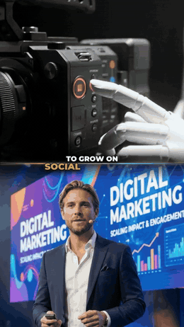
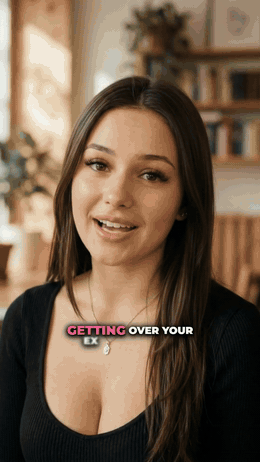
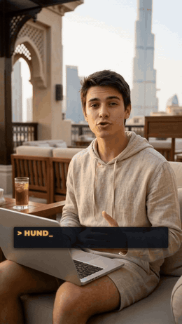
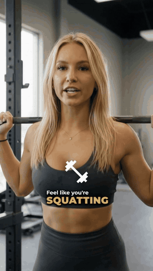
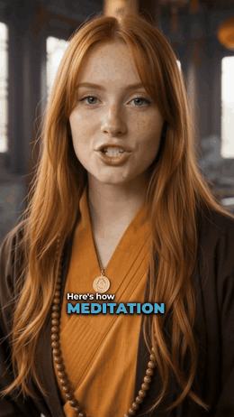
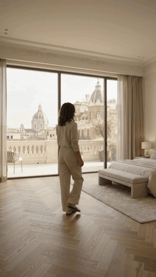
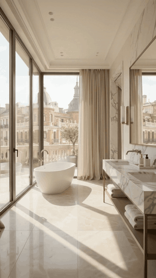
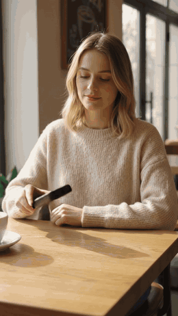

<div align="center">

# ⚡ OdinMCP — Official OdinxD AI Video Studio MCP Server

**Turn Claude, Cursor, Antigravity & Windsurf into an Autonomous 9:16 AI Video Production Studio.**  
*Convierte Claude, Cursor, Antigravity y Windsurf en un Estudio Autónomo de Producción de Video Vertical 9:16 con IA.*

[](https://modelcontextprotocol.io)
[-10B981?style=for-the-badge)](./package.json)
[](#3-render-modes--live-video-previews--modos-de-render-y-vistas-previas)
[](./LICENSE)

**[🌐 Website](https://odinxd.com)** • **[📖 Interactive Docs & API v1](https://odinxd.com/docs)** • **[🔑 Get API Key](https://odinxd.com/dashboard?section=mcp)** • **[🤖 Agent Manifest (`/llms.txt`)](https://odinxd.com/llms.txt)**

</div>

---

## 1. Overview / ¿Qué es OdinMCP?

**English:**  
**OdinMCP (`v2.2.0`)** (`@odinxd/mcp-server`) is the official **Model Context Protocol (MCP)** studio & Creative Skill Suite for **[OdinxD](https://odinxd.com)**. It transforms Claude Code, Claude Desktop, Cursor, Antigravity, and Windsurf into a **complete end-to-end AI Video Production Studio**:

- **🔥 NEW in `v2.2` — Atomic Generative AI Image & Video APIs (`ai_credits` only • `0` Cloud Renders Consumed):**
  - **`generate_ai_image` (`gemini-2.5-flash-image` — `1` AI credit/image):** Generate or composite realistic UGC creators holding real products (supports all 4 combinations: no photos, product photo only, avatar photo only, or fusing separate avatar + product photos into one cohesive `9:16` frame), Microdrama character casting portraits, and cinematic keyframes.
  - **`generate_ai_video_clip` & `generate_ai_video_batch` (`gemini-omni-1.2-flash` — `3s` to `15s`, up to `10` parallel clips/batch):** Native Lip-Sync spoken dialogue or diegetic cinema foley at **`1` AI credit/sec** (no reference images) or **`2` AI credits/sec** (with avatar/product/casting references). Includes **English Voice Library locks** (`Aoede`, `Zephyr`, `Kore`, `Leda`, `Vindemiatrix`, `Puck`, `Fenrir`, `Charon`, `Orus`, `Achird`) and **Spanish Dialect Acoustic Locks** (`es_mx_*`, `es_es_*`, `es_co_*`, `es_ar_*`) for multi-take `30s–60s+` ads. **Your agent writes 100% of scripts using your own Claude/LLM session (zero OdinxD LLM cost).**
  - **Local Voiceover & Timeline Assembler (`$0` Cloud Render Cost):** `generate_local_voiceover` (`edge-tts` MP3 + SRT) and `assemble_local_timeline` (`1080x1920` / `1920x1080 @ 30fps`, `-16 LUFS`, native Lip-Sync or voiceover + SFX ducking, and local `faster-whisper` burned captions) master full `30s–90s+` commercials and episodes directly on your PC!
  - **4 Official Installable Creative Skills (`skills/`):**
    1. `odin-ugc-factory` — Batch `15s` UGC ad variations (e.g. *"Generate 10 short 15s UGC ads"*) & multi-take `30s–60s+` UGC commercials.
    2. `odin-cinematic-faceless` — Luxury Apple/Nike-style Faceless commercials & mini-documentaries rendered 100% locally.
    3. `odin-microdrama-director` — Serialized `9:16` AI Microdramas with persistent Casting Bibles & scene-by-scene direction.
    4. `odin-video-preproduction` — Local raw A-Roll mistake/silence cleaner, `9:16` podcast clipper & personal local B-Roll stock bank (`~/.odinxd/stock_bank`).
- **6 Cloud Studio Render Engines & 20 AI B-Roll Styles:** ViralBeat 2.0, Hybrid AI B-Roll, Zero-Camera Faceless AI Ads, Real Estate Multi-Room Tours, Motion Stock, Maxy Overlay, and Fitness Talking-Head.
- **Fair Per-Item Billing & 0-Charge Fail-Fast Protection:** If any clip in a batch fails, its AI credits are automatically refunded; if a full job fails, **100% of credits are refunded**.

**Español:**  
**OdinMCP (`v2.2.0`)** convierte a Claude, Cursor, Antigravity y Windsurf en un **Estudio Completo de Producción y Edición de Video con IA**:
- **NUEVO en `v2.2` — APIs Atómicas de Imagen y Video IA + Ensamblador Local (`0` Renders Consumidos):** Pídele a Claude *"Genérame 10 anuncios UGC cortos de 15 segundos"* o *"Crea un anuncio UGC de 45s / un comercial Faceless cinematográfico / un episodio de Microdrama de 60s"*. Claude redacta el guion con su propia cuota, compone al avatar con tu producto (`1` crédito IA/imagen), genera las tomas de `3s` a `15s` con **Omni 1.2 Flash** (`1` crédito IA/s sin referencias o `2` créditos IA/s con referencias) manteniendo consistencia vocal entre tomas, y **une y subtitula el master final gratis en tu propio ordenador** (`assemble_local_timeline`).
- **Preproducción Local (`0` Créditos) + 6 Motores Cloud Remotion:** Limpia silencios y errores hablados con FFmpeg + Whisper local, extrae clips `9:16` de podcasts, crea tu banco de stock local y renderiza en `odinxd.com` cuando quieras Motion Graphics avanzados.

---

## 2. Table of Contents / Índice

1. [Overview / ¿Qué es OdinMCP?](#1-overview--qué-es-odinmcp)
2. [Render Modes & Live Video Previews / Modos de Render y Vistas Previas](#3-render-modes--live-video-previews--modos-de-render-y-vistas-previas)
3. [Specialty AI B-Roll Showcases (Real Estate & UGC)](#4-specialty-ai-b-roll-showcases--estilos-especiales-inmobiliario-y-ugc)
4. [Step-by-Step Tutorial (0 to Video in 3 Min) / Tutorial Paso a Paso](#5-step-by-step-tutorial--tutorial-paso-a-paso-en-3-minutos)
5. [Real-World Prompt & Tool Examples / Ejemplos Prácticos](#6-real-world-examples--ejemplos-prácticos-de-uso)
6. [Complete MCP Tools Reference (20 Tools)](#7-complete-mcp-tools-reference-20-tools-13-cloudgenai--7-local-studio)
7. [Catalog of All 20 AI B-Roll Styles & 13 Real Estate Rooms](#8-catalog-of-20-ai-b-roll-styles--catálogo-de-20-estilos-ia-y-estancias)
8. [Golden Rules for AI Agents & Local Sandbox Security](#9-golden-rules-for-ai-agents--reglas-de-oro-y-seguridad)

---

## 3. Render Modes & Live Video Previews / Modos de Render y Vistas Previas

> 💡 **Click any animated preview** to open the HD `.mp4` video with audio inside [`previews/videos/`](./previews/videos), or watch the full-length showcase on **[odinxd.com](https://odinxd.com)**.  
> *(Haz clic en cualquier vista previa animada para abrir el clip `.mp4` con audio).*

<table>
  <tr>
    <td align="center" width="33%" valign="top">
      <a href="./previews/videos/viral_beat.mp4">
        
      </a>
      <br />
      <b>⚡ 1. ViralBeat 2.0</b><br />
      <code>render_viral_beat</code><br /><br />
      <sub><b>EN:</b> Extreme-retention pacing with punch-in zooms, split-screens, SFX, kinetic captions &amp; contextual AI B-Roll.<br /><b>ES:</b> Motor de retención extrema con zoom punch, pantallas divididas, efectos de sonido y B-Roll con IA.<br /><br />🎬 <a href="./previews/videos/viral_beat.mp4">Repo MP4</a> • <a href="https://odinxd.com/landing/preview_viral_beat.mp4">Full HD Video</a></sub>
    </td>
    <td align="center" width="33%" valign="top">
      <a href="./previews/videos/hybrid_reel.mp4">
        
      </a>
      <br />
      <b>🎬 2. Hybrid AI B-Roll</b><br />
      <code>render_hybrid_reel</code><br /><br />
      <sub><b>EN:</b> Alternates clean speaker A-Roll with 20 bespoke AI B-Roll styles (Avatar, Real Estate, UGC, 3D Parallax, VOX).<br /><b>ES:</b> Intercala tu video hablado a cámara con 20 estilos de B-Roll generados por IA según lo que dice tu guion.<br /><br />🎬 <a href="./previews/videos/hybrid_reel.mp4">Repo MP4</a> • <a href="https://odinxd.com/landing/preview_hybrid.mp4">Full HD Video</a></sub>
    </td>
    <td align="center" width="33%" valign="top">
      <a href="./previews/videos/faceless_ads.mp4">
        
      </a>
      <br />
      <b>🎯 3. Faceless AI Ads</b><br />
      <code>create_faceless_ad</code><br /><br />
      <sub><b>EN:</b> 100% text-to-commercial without filming: AI scriptwriting + 24 neural TTS voices + AI scenes + BPM music.<br /><b>ES:</b> Comerciales 9:16 completos sin grabar cámara: guion IA + 24 voces neurales + escenas IA + música BPM.<br /><br />🎬 <a href="./previews/videos/faceless_ads.mp4">Repo MP4</a> • <a href="https://odinxd.com/landing/tutorial_faceless.mp4">Full Walkthrough</a></sub>
    </td>
  </tr>
  <tr>
    <td align="center" width="33%" valign="top">
      <a href="./previews/videos/motion_stock.mp4">
        
      </a>
      <br />
      <b>📊 4. Motion Stock (0 AI Credits)</b><br />
      <code>render_motion_stock</code><br /><br />
      <sub><b>EN:</b> Pure Remotion documentary &amp; viral Motion Graphics overlays, HUDs, charts &amp; kinetic typography (0 AI credits).<br /><b>ES:</b> Motion Graphics puros de nivel agencia (gráficas, HUDs, comparativas y tipografía cinética) con 0 créditos IA.<br /><br />🎬 <a href="./previews/videos/motion_stock.mp4">Repo MP4</a> • <a href="https://odinxd.com/landing/preview_motion_stock.mp4">Full HD Video</a></sub>
    </td>
    <td align="center" width="33%" valign="top">
      <a href="./previews/videos/maxy_overlay.mp4">
        
      </a>
      <br />
      <b>✨ 5. Maxy Overlay (0 AI Credits)</b><br />
      <code>render_maxy_overlay</code><br /><br />
      <sub><b>EN:</b> Stacked 3D kinetic typography and animated contextual icons floating over continuous A-Roll without cuts.<br /><b>ES:</b> Tipografía 3D apilada e iconos animados flotando sobre tu toma continua sin tapar al creador (0 créditos IA).<br /><br />🎬 <a href="./previews/videos/maxy_overlay.mp4">Repo MP4</a> • <a href="https://odinxd.com/landing/preview_maxy_overlay.mp4">Full HD Video</a></sub>
    </td>
    <td align="center" width="33%" valign="top">
      <a href="./previews/videos/fitness_talking_head.mp4">
        
      </a>
      <br />
      <b>🔥 6. Fitness &amp; Personal Brand (0 AI)</b><br />
      <code>render_fitness_talking_head</code><br /><br />
      <sub><b>EN:</b> Direct-to-camera talking-head mastery with punchy boxed highlighter / dynamic pop captions (0 AI credits).<br /><b>ES:</b> Edición directa a cámara de alto impacto para coaches, fitness y marca personal con subtítulos magnéticos.<br /><br />🎬 <a href="./previews/videos/fitness_talking_head.mp4">Repo MP4</a> • <a href="https://odinxd.com/landing/preview_fitness.mp4">Full HD Video</a></sub>
    </td>
  </tr>
</table>

---

## 4. Specialty AI B-Roll Showcases / Estilos Especiales: Inmobiliario y UGC

OdinxD includes **intelligent multi-reference AI B-Roll engines** for **Real Estate Agents** (automatically matching the spoken script to the exact uploaded room photo) and **E-Commerce Brands** (integrating real product packaging into realistic UGC shots):

<table>
  <tr>
    <td align="center" width="33%" valign="top">
      <a href="./previews/videos/inmo_avatar_stock.mp4">
        
      </a>
      <br />
      <b>🏡 Real Estate Avatar Tour</b><br />
      <code>inmo_avatar_stock</code><br /><br />
      <sub><b>EN:</b> Places the agent's avatar inside the exact property room mentioned in the script (kitchen, suite, terrace).<br /><b>ES:</b> Integra el avatar del asesor inmobiliario recorriendo la estancia exacta que menciona el guion.<br /><br />🎬 <a href="./previews/videos/inmo_avatar_stock.mp4">Watch MP4</a></sub>
    </td>
    <td align="center" width="33%" valign="top">
      <a href="./previews/videos/inmo_tour_transition.mp4">
        
      </a>
      <br />
      <b>🚪 Multi-Room POV Transition</b><br />
      <code>inmo_tour_transition</code><br /><br />
      <sub><b>EN:</b> Continuous gimbal-stabilized POV walkthrough connecting 2–3 real property rooms in a single fluid shot.<br /><b>ES:</b> Recorrido continuo en primera persona (POV) que conecta de 2 a 3 fotos reales del inmueble con transición en cámara.<br /><br />🎬 <a href="./previews/videos/inmo_tour_transition.mp4">Watch MP4</a></sub>
    </td>
    <td align="center" width="33%" valign="top">
      <a href="./previews/videos/ugc_stock.mp4">
        
      </a>
      <br />
      <b>🛍️ UGC Product Commercial</b><br />
      <code>ugc_stock</code><br /><br />
      <sub><b>EN:</b> Realistic creator hands &amp; lifestyle B-Roll interacting with 1–3 uploaded photos of your real physical product.<br /><b>ES:</b> Tomas hiperrealistas estilo creador UGC interactuando con 1 a 3 fotos reales de tu producto físico.<br /><br />🎬 <a href="./previews/videos/ugc_stock.mp4">Watch MP4</a></sub>
    </td>
  </tr>
</table>

---

## 5. Step-by-Step Tutorial / Tutorial Paso a Paso en 3 Minutos

### Step 1 — Generate Your Personal API Key / Obtén tu API Key
1. Sign up or sign in at **[https://odinxd.com/dashboard?section=mcp](https://odinxd.com/dashboard?section=mcp)** and activate a **Starter** or **Pro** plan *(you can also add extra AI credit packs anytime to scale massive batches)*.
2. In the **🔌 OdinxD MCP Server & API Keys** section (open automatically at the top), click **+ Generate New API Key** and copy your `odx_live_...` token.

---

### Step 2 — Connect Your AI Client / Conecta tu Agente IA

Choose **Mode A (Local PC Bridge — Recommended if your `.mp4`/`.jpg` files are on your computer)** or **Mode B (Remote Streamable HTTP — Zero install for cloud URLs & Faceless Ads)**.

#### 💻 Mode A: Local PC Bridge (Uploads Local Files & Downloads Final `.mp4` Automatically)
Requires **Node.js `>= 18`**. Zero external npm dependencies (`~18 KB` source).

**Option A1 — Instant Clone & Run (Universal across all Node/npm versions, zero startup latency):**
```bash
git clone https://github.com/odinxd-ai/OdinMCP.git
```
Then add to **Claude Desktop (`claude_desktop_config.json`) / Cursor (`mcp.json`) / Antigravity / Windsurf**:
```json
{
  "mcpServers": {
    "odinxd": {
      "command": "node",
      "args": ["/absolute/path/to/OdinMCP/bin/odinxd-mcp.mjs"],
      "env": {
        "ODINXD_API_KEY": "odx_live_YOUR_KEY"
      }
    }
  }
}
```

**Option A2 — Direct `npx` from GitHub (`--allow-git=all` supports npm v12+):**
```bash
claude mcp add odinxd -e ODINXD_API_KEY=odx_live_YOUR_KEY -- npx --allow-git=all -y github:odinxd-ai/OdinMCP
```
```json
{
  "mcpServers": {
    "odinxd": {
      "command": "npx",
      "args": ["--allow-git=all", "-y", "github:odinxd-ai/OdinMCP"],
      "env": {
        "ODINXD_API_KEY": "odx_live_YOUR_KEY"
      }
    }
  }
}
```

**Option A3 — Claude Code Full Plugin + All 4 Exclusive Creative Skills (`odin-ugc-factory`, `odin-cinematic-faceless`, `odin-microdrama-director`, `odin-video-preproduction`):**
```bash
# Inside Claude Code interactive session (installs MCP + all 4 Skills automatically):
/plugin marketplace add odinxd-ai/OdinMCP
/plugin install odinmcp@odinxd

# Or install all 4 Skills into Claude Code / Cursor / Antigravity / Windsurf:
npx skills add odinxd-ai/OdinMCP
```

#### ☁️ Mode B: Remote Streamable HTTP (Zero Local Code — Cloud URLs & Faceless Ads)

**Claude Code (CLI):**
```bash
claude mcp add --transport http odinxd https://odinxd.com/api/mcp \
  --header "Authorization: Bearer odx_live_YOUR_KEY"
```

**Cursor / Antigravity / Windsurf (`mcp.json`):**
```json
{
  "mcpServers": {
    "odinxd": {
      "url": "https://odinxd.com/api/mcp",
      "headers": {
        "Authorization": "Bearer odx_live_YOUR_KEY"
      }
    }
  }
}
```

**Claude Desktop via `mcp-remote` (`claude_desktop_config.json`):**
```json
{
  "mcpServers": {
    "odinxd": {
      "command": "npx",
      "args": [
        "-y",
        "mcp-remote",
        "https://odinxd.com/api/mcp",
        "--header",
        "Authorization: Bearer odx_live_YOUR_KEY"
      ]
    }
  }
}
```

---

### Step 3 — Ask Your Agent in Natural Language / Pídele tu Video en Lenguaje Natural

Once connected, verify by asking:
> *"Check my OdinxD quota and list the available AI B-Roll styles."*  
> *(Consulta mi saldo en OdinxD y dime qué estilos de B-Roll con IA están disponibles).*

---

## 6. Real-World Examples / Ejemplos Prácticos de Uso

### Example 1 — Real Estate Multi-Room Reel (Español / English)
**Prompt to Claude / Cursor:**
> *"Toma mi video limpio `C:/Inmuebles/penthouse_aroll.mp4`, mi foto de perfil `C:/Inmuebles/agente.jpg` y estas fotos del departamento: `cocina.jpg`, `sala.jpg` y `terraza.jpg`. Genera un reel en Modo Híbrido con estilo `inmo_avatar_stock`, tipografía `Playfair Display` y subtítulos `kinetic_blur`, y guárdalo en mi Escritorio cuando termine."*

**Underlying MCP Tool Call (`render_hybrid_reel`):**
```json
{
  "video_url": "C:/Inmuebles/penthouse_aroll.mp4",
  "ai_styles": ["inmo_avatar_stock", "inmo_tour"],
  "clips_count": 3,
  "clip_duration": 5,
  "typography": "Playfair Display",
  "subtitle_style": "kinetic_blur",
  "avatar_image": "C:/Inmuebles/agente.jpg",
  "inmo_photos": [
    { "url": "C:/Inmuebles/cocina.jpg", "room": "cocina" },
    { "url": "C:/Inmuebles/sala.jpg", "room": "sala" },
    { "url": "C:/Inmuebles/terraza.jpg", "room": "terraza" }
  ]
}
```

### Example 2 — Zero-Camera Faceless AI Ad (`create_faceless_ad`)
```json
{
  "product_name": "Aurum Cold Brew Concentrate",
  "description": "Specialty Colombian cold brew ready in 5 seconds. Zero sugar, 2x natural caffeine, smooth chocolate notes. 20% off starter kit today.",
  "faceless_mode": "commercial_narrated",
  "target_duration": 30,
  "lang": "en",
  "voice_id": "odin_pro_en",
  "subtitle_style": "kinetic_dinamic",
  "typography": "Montserrat",
  "bg_music": "minimal_luxury_122",
  "product_images": ["C:/Brand/bottle_front.png", "C:/Brand/pour_shot.jpg"]
}
```

### Example 3 — Zero-AI-Credit Motion Graphics Reel (`render_motion_stock`)
```json
{
  "video_url": "C:/Videos/saas_metrics_clean.mp4",
  "typography": "Space Grotesk",
  "subtitle_style": "kinetic_dinamic",
  "highlight_color": "#D4AF37"
}
```

---

### Example 4 — Batch of 10 Short 15s UGC Ads or 45s Multi-Take UGC (`odin-ugc-factory`)
**Prompt to Claude / Cursor:**
> *"Generame 10 videos UGC cortos de 15 segundos en inglés promocionando mi sérum de vitamina C `C:/Brand/serum.png` con distintos ganchos y creadores. Guárdalos en `~/Desktop/ugc_10_ads`."*  
> *(Or: "Hazme un anuncio UGC de 45 segundos donde el avatar `C:/Brand/creadora.jpg` sostenga mi producto `C:/Brand/serum.png`, mantenga la misma voz `Aoede` en las 3 tomas y únelo en local con subtítulos limpios").*

1. Claude composites the avatar holding the exact product (`generate_ai_image` -> `1` AI credit/image).
2. Claude writes the scripts (28–32 words per 15s take) and calls `generate_ai_video_batch` (`clip_mode: "ugc_talking"`, `voice_preset: "Aoede"`).
3. For 30s–60s+ ads, Claude stitches all takes locally at `$0` render cost via `assemble_local_timeline`.

---

## 7. Complete MCP Tools Reference (20 Tools: 13 Cloud/GenAI + 7 Local Studio)

### A. Atomic Generative AI Media APIs (`ai_credits` ONLY • `0` Cloud Renders Consumed)
| Tool | Credit Pricing | Purpose |
| :--- | :--- | :--- |
| `generate_ai_image` | **`1` AI credit / image** (`0` renders) | Generates or composites `1..4` images via `gemini-2.5-flash-image`: UGC avatar holding product (all 4 input combinations), Microdrama character casting sheets, or cinematic keyframes. |
| `generate_ai_video_clip` | **`1` credit/s** (no refs) • **`2` credits/s** (with refs) | Generates a `3s–15s` native `gemini-omni-1.2-flash` video clip with Lip-Sync speech (`Aoede`, `Zephyr`, `Kore`, `Puck`, `Charon`, `es_mx_*`, `es_es_*`...) or diegetic cinema foley (`0` renders). |
| `generate_ai_video_batch` | **`1` credit/s** (no refs) • **`2` credits/s** (with refs) | Generates **`1` to `10` clips in parallel** in a single job (e.g., 10×15s UGC ad hooks, 3–4 multi-take scenes for a 45s UGC ad, or a full Microdrama episode) with automatic per-clip refund on failure. |

### B. Local Pre-Production & Timeline Assembly Tools (`100% Local CPU • 0 Cloud Credits`)
| Tool | Credits & Cost | Purpose |
| :--- | :--- | :--- |
| `local_preprod_doctor` | **Free (`0` credits)** | Verifies `ffmpeg` & Python and auto-provisions `~/.odinxd/preprod_env` (`faster-whisper`, `yt-dlp`, OpenCV, `PySceneDetect`, `edge-tts`). |
| `transcribe_local_media` | **Free (`0` credits)** | Word-timestamped local Whisper transcription + acoustic silence map across 1..N raw takes to spot spoken mistakes/retakes. |
| `clean_and_merge_aroll` | **Free (`0` credits)** | Removes dead silences & spoken retakes across 1..N raw files, applies `25ms` anti-pop fades + `-16 LUFS` & outputs **1 clean 9:16 MP4**. |
| `extract_podcast_clips` | **Free (`0` credits)** | Analyzes long podcasts/URLs (`yt-dlp` + Whisper) and extracts `9:16` viral clips with stabilized OpenCV face-centering. |
| `manage_local_stock_bank` | **Free (`0` credits)** | Slices user videos into reusable `3–5s` `9:16` B-Roll clips + `.jpg` keyframes in `~/.odinxd/stock_bank` & outputs `customStockParam`. |
| `generate_local_voiceover` | **Free (`0` credits)** | Synthesizes neural `.mp3` voiceovers + synchronized `.srt` subtitles locally via `edge-tts` for Cinematic Faceless ads & documentaries. |
| `assemble_local_timeline` | **Free (`0` credits)** | Stitches multi-take UGC ads (`30s–60s+`), Faceless commercials, or Microdrama episodes locally in `1080x1920` / `1920x1080 @ 30fps` (`-16 LUFS` + optional local Whisper/SRT burned captions). |

### C. OdinxD Cloud Studio Render & Account Tools (`https://odinxd.com`)
| Tool | Credits & Render Cost | Purpose |
| :--- | :--- | :--- |
| `get_account_quota` | **Free** (`0` renders • `0` AI) | Returns active plan, remaining renders, and AI credit balance. |
| `get_odinxd_catalog` | **Free** (`0` renders • `0` AI) | Lists Omni 1.2 Flash voices (`omni_voices`), all 20 AI B-Roll styles, 13 real estate room tags, 15 fonts, subtitles, Motion components, 24 TTS voices & music. |
| `create_faceless_ad` | `1` render + scene AI seconds | Full 9:16 cloud Remotion commercial from text: AI script + neural TTS voiceover + AI storyboard + cloud render. |
| `render_hybrid_reel` | `1` render + (`clips_count × clip_duration` × multiplier) | Edits a single clean A-Roll video alternating with 20 AI B-Roll styles (including Real Estate & UGC). |
| `render_viral_beat` | `1` render + (`ai_clips_count × ai_clip_duration` × multiplier) | High-retention ViralBeat 2.0 edit with dynamic zoom punches, split-screens, SFX & AI B-Roll. |
| `render_motion_stock` | `1` render • **`0` AI credits** | Pure Remotion Motion Graphics & data visualizations over clean A-Roll. |
| `render_maxy_overlay` | `1` render • **`0` AI credits** | Stacked 3D kinetic typography and animated contextual icons over continuous A-Roll. |
| `render_fitness_talking_head` | `1` render • **`0` AI credits** | High-retention talking-head captions (`boxed_highlighter` / `dynamic`) for coaches & creators. |
| `get_render_status` | **Free** (`0` renders • `0` AI) | Real-time status (`pending`, `rendering`, `done`, `failed`), progress %, multi-item `assetRef`/`downloadUrl` & error recovery hints. |
| `wait_for_render` | **Free** *(Local Bridge)* | Polls until completion and automatically downloads finished HD `.mp4`/`.png` outputs to your PC. |

---

## 8. Catalog of 20 AI B-Roll Styles / Catálogo de 20 Estilos IA y Estancias

| Style ID (`ai_styles`) | Category | Credit Multiplier | Required Reference Assets |
| :--- | :--- | :---: | :--- |
| `stock_hyperreal` | Cinematic Realism (No Faces) | `1x` | None |
| `cinematic_macro` | Slow-Motion Macro Detail | `1x` | None |
| `avatar_stock` | Creator Avatar in AI Scene | `2x` | `avatar_image` (private creator face) |
| `ugc_stock` | E-Commerce Product UGC | `2x` | `product_images` (1–3 real product photos) |
| `inmo_avatar_stock` | Real Estate Agent in Room | `2x` | `avatar_image` + `inmo_photos` (≥ 1 room) |
| `inmo_tour_transition` | Multi-Room POV Walkthrough | `2x` | `inmo_photos` (≥ 2 rooms) |
| `inmo_tour` | Single-Room Architectural Tour | `2x` | `inmo_photos` (≥ 1 room) |
| `scrapbook_polaroid` | 2.5D Collage & Mixed Media | `1x` | None |
| `parallax_3d` | 3D Depth Canvas Pan | `1x` | None |
| `vox_editorial` | Documentary Editorial Motion | `1x` | None |
| `ui_interface_dark` | SaaS / App Glass UI Showcase | `1x` | Optional `saas_image` |
| `swiss_design` | Minimalist Swiss Grid | `1x` | None |
| `mannequin_3d` | Spotlight 3D Mannequin Metaphor | `1x` | None |
| `isometric_clay` | Tactile 3D Isometric Miniature | `1x` | None |
| `cyber_blueprint` | Holographic Wireframe & Tech | `1x` | None |
| `dark_glassmorphism` | Frosted Luxury 3D Glass | `1x` | None |
| `diorama_3d` | Layered Papercraft Diorama | `1x` | None |
| `graphic_noir` | High-Contrast Halftone Noir | `1x` | None |
| `gradient_abstract` | Kinetic Fluid Mesh Background | `1x` | None |
| `motion_dark_minimal` | Dark Minimalist Executive | `1x` | None |

**Supported Real Estate Room IDs (`inmo_photos[].room`):**  
`fachada_exterior`, `sala`, `comedor`, `cocina`, `habitacion_principal`, `habitacion_secundaria`, `bano`, `vestidor`, `terraza`, `jardin_piscina`, `estudio_oficina`, `lobby_amenidades`, `otro` *(auto-inferred from filenames like `cocina.jpg` or `master_suite.png` when using the Local Bridge!).*

---

## 9. Golden Rules for AI Agents / Reglas de Oro y Seguridad

1. **Single Clean A-Roll Video (`video_url`):**  
   OdinxD works exclusively with **one continuous, clean base video** (already trimmed without long silences, filler pauses, or spoken retakes) and does **not** concatenate multiple base videos into one timeline. If the user provides raw takes on their PC, the AI agent should first trim silences and concatenate takes locally using FFmpeg before invoking OdinxD.
2. **Private Creator Faces Only on Avatar Styles (`PROMINENT_PERSON_BLOCKED`):**  
   `avatar_stock`, `ugc_stock`, and `inmo_avatar_stock` strictly accept photos of private creators or clients. Celebrity, politician, or famous podcaster faces are blocked by upstream generative safety filters. For commentary on public figures, always choose non-avatar styles (`stock_hyperreal`, `cinematic_macro`, `scrapbook_polaroid`, `parallax_3d`, `vox_editorial`).
3. **Art Direction Defaults by Niche:**  
   - **General / Creators:** `typography: "Montserrat"`, `subtitle_style: "kinetic_dinamic"`
   - **Luxury Real Estate / High-Ticket:** `typography: "Playfair Display"`, `subtitle_style: "kinetic_blur"`
   - **SaaS / AI / Tech:** `typography: "Space Grotesk"`, `subtitle_style: "kinetic_dinamic"`
   - **Fitness / Direct Coaching:** `typography: "Bebas Neue"`, `subtitle_style: "boxed_highlighter"`
4. **Hardened Local Bridge Sandbox (`v2.2.0`):**  
   - Zero third-party npm packages on startup (100% auditable Node.js built-ins; Python media wheels are isolated on-demand inside `~/.odinxd/preprod_env`).
   - Blocks symbolic links (`lstat`), sensitive paths (`.ssh`, `.aws`, `.git`, `.env`), shell interpolation (`shell: false`), and non-multimedia extensions.
   - Enforces `https://` transport and strict `.mp4`/image output validation on automated downloads.

---

## License

Released under the [MIT License](./LICENSE) © 2026 **[OdinxD](https://odinxd.com)**.
